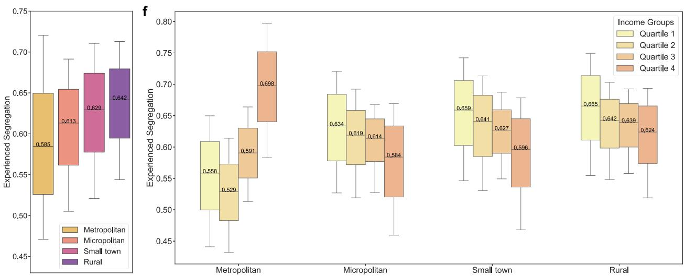

# Varying relationships between experienced income segregation and travel behaviour across neighbourhood social and urban contexts

Yuxuan Zhou; Yi Lu · Nature Communications · 2025

[来源](https://doi.org/10.1038/s41467-025-66585-z)

## 作者摘要

Income segregation is a barrier to social inclusivity and equity. It is affected by individuals' travel behaviour and socioeconomic status and may be intensified by localised living models emphasising conducting daily activities within immediate neighbourhoods. However, how the relationship between experienced income segregation and travel behaviour varies across neighbourhood social and urban contexts remains unclear. Here, we quantify experienced income segregation using a dataset of 1.2 billion mobility records from the contiguous United States and examine its relationships with travel distance and diversity across neighbourhoods with different social and urban contexts. We find that longer travel distances and more diverse destinations are associated with less experienced segregation for least affluent neighbourhoods, especially in less urbanised areas. Our findings underscore the need for urban planning and transport interventions to increase mobility and social integration opportunities for residents from socially disadvantaged neighbourhoods. They also highlight the potential adverse social consequences of localised living models.

## 中文译文

收入隔离是社会包容与公平的障碍，受个体出行行为和社会经济地位影响，并可能因强调在即时邻里内完成日常活动的本地化生活模式而加剧。然而，经历的收入隔离与出行行为之间的关系如何随邻里社会和城市情境变化，仍不清楚。本文利用美国本土48州12亿条移动记录量化经历的收入隔离，考察其与不同社会和城市情境邻里出行距离及目的地多样性的关系。结果发现，对于最不富裕的邻里，更长的出行距离和更多样化的目的地与较低的经历隔离相关，这一关系在城市化程度较低地区尤其明显。研究强调，需要通过城市规划和交通干预增加社会弱势邻里居民的移动机会与社会融合机会，也提示本地化生活模式可能产生不利的社会后果。

## 阅读提要

经历型分异与距离及目的地多样性的关联因城市情境而异

Fig. 1 | Patterns of experienced segregation. a Spatial patterns of experienced segregation in the contiguous United States (presented here at the census tract level rather than the census block group (CBG) level for the purpose of data visualisation). We selected and zoomed in on three representative metropolitan statistical areas (MSAs) with distinct levels of experienced segregation: b Miami–Fort Lauderdale–Pompano Beach, Florida (average segregation: 0.559), c Los Angeles–Long Beach–Anaheim, California (average segregation: 0.602), and d Boston–Cambridge–Newton, Massachusetts–New Hampshire (average segregation: 0.651). The experienced segregation was categorised into quintiles, with quintiles 1–5 corresponding to low, moderate-low, moderate, moderate-high, and high levels, respectively. e Distribution of overall experienced segregation at the neighbourhood level across different urbanicity levels. f Distribution of overall experienced segregation across various income quartiles in distinct urbanicity levels, with income quartiles defined separately for each urbanicity level. In e, f n = 167,780, 20,580, 10,847, 8,683 neighbourhoods in metropolitan areas, micropolitan areas, small towns, and rural areas, respectively. The box plots in e, f present the 10th, 25th, 50th, 75th, and 90th percentiles.

本地MinerU提取的原图与图注 · CC BY 4.0 · Yuxuan Zhou; Yi Lu · 10.1038/s41467-025-66585-z

