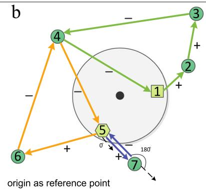
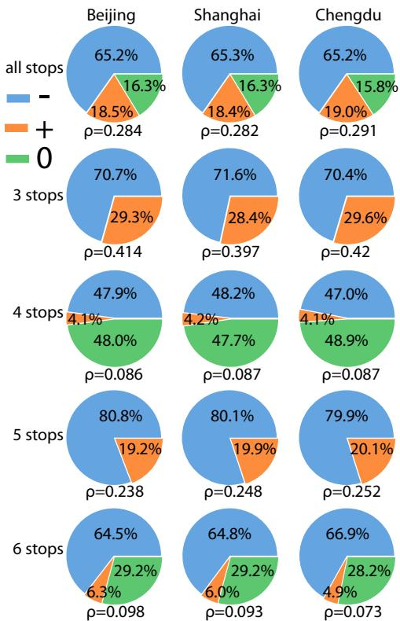
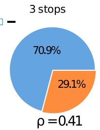
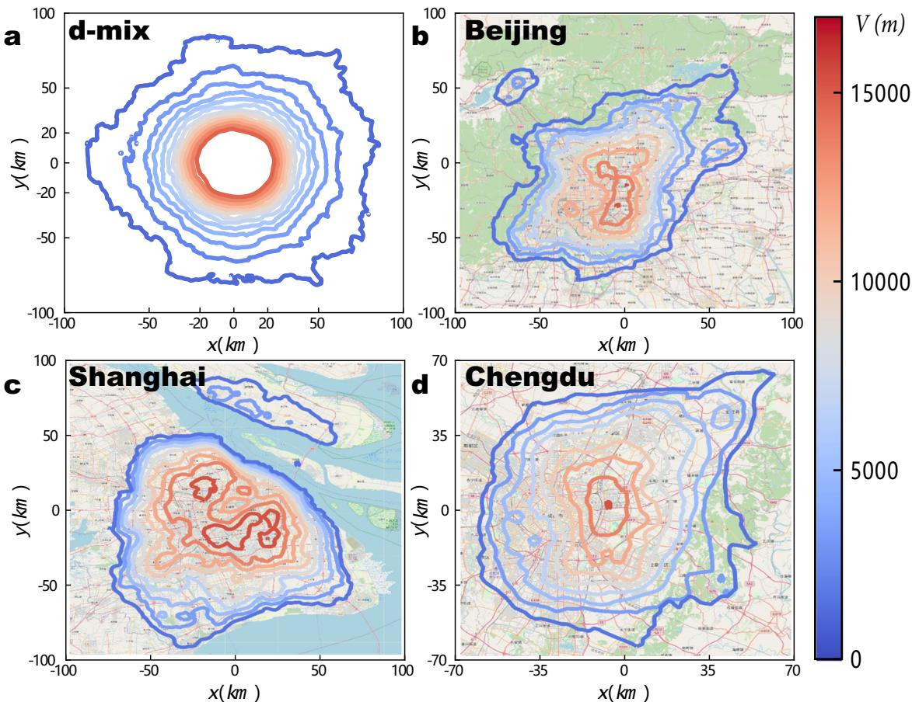

# A generalized vector-field framework for mobility

Erjian Liu; Mattia Mazzoli; Xiao-Yong Yan; José J. Ramasco · Communications Physics · 2024

[来源](https://doi.org/10.1038/s42005-024-01672-z)

## 作者摘要

Abstract Given the identification with travel demand and its relevance for transportation and urban planning, the estimation of trip flows between areas is a fundamental metric for human mobility. Previous models focus on flow intensity, disregarding the information provided by the local mobility orientation. A field-theoretic approach can overcome this issue and handle both intensity and direction at once. Here we propose a general vector-field representation starting from individuals’ trajectories valid for any type of mobility. We also show with simplified models how individuals’ choices determine the mesoscopic properties of the mobility field. Distance optimization in long displacements and random-like local exploration are necessary to reproduce empirical field features observed in Chinese logistic data and in New York City Foursquare check-ins. Our framework is able to capture hidden symmetries in mesoscopic urban mobility and opens the doors to the use of field theory in a wide spectrum of applications.

## 中文译文

鉴于出行需求识别及其对交通和城市规划的重要性，估计区域间出行流是衡量人类移动的基本指标。既有模型关注流量强度，却忽略当地移动方向信息。场论方法可以同时处理强度和方向。本文提出一种从个体轨迹出发、适用于任何移动类型的通用矢量场表示，并通过简化模型说明个体选择如何决定移动场的介观性质。长距离移动中的距离优化与类似随机的局部探索，是复现中国物流数据和纽约市Foursquare签到数据中经验场特征所必需的。该框架能够捕捉介观城市移动中的隐藏对称性，并为场论在广泛应用中的使用打开空间。

## 阅读提要

从轨迹得到移动方向场和介观结构

Fig. 1 | Definition of trajectories orientation and resulting vector field. The large gray circle stands for an idealized city (with the black point as the city center), the green numbered circles are the stops sequence of each trajectory $( 1 - 2 - 3 - 4 - 1 , 5 - 6 - 4 - 5$ and $5 \mathrm { - } 7 \mathrm { - } 5 )$ , while the square in 1 and the hexagon in 5 are the trajectories' origins. a City center as reference point (RP). Vectors ofeach color connect consecutive stops of a trajectory, for example, the trajectory 1-2-3-4-1. When the vector connecting X to Y forms an acute angle with the position vector $\vec { X }$ starting in the city center, we mark the vector XY as positive, meaning that the agent is moving away from the city

本地MinerU提取的原图与图注 · CC BY 4.0 · Erjian Liu; Mattia Mazzoli; Xiao-Yong Yan; José J. Ramasco · 10.1038/s42005-024-01672-z

Fig. 2 | Unbalance of empirical trajectories. Fraction ofpositive (orange), negative (blue), and balanced (green) trajectories with 3, 4, 5, 6 stops and for all trajectories of trucks departing from Beijing, Shanghai and Chengdu, using the trajectory origin as reference point(RP). ρ stands for the ratio between the number of positive and negative trajectories.

本地MinerU提取的原图与图注 · CC BY 4.0 · Erjian Liu; Mattia Mazzoli; Xiao-Yong Yan; José J. Ramasco · 10.1038/s42005-024-01672-z

Fig. 4 | Models and trajectory unbalance. a Violin plots ofthe model-predicted and real values of the unbalnace ratio ρ for trajectories with different number stops. The violin plots depict the values of ρ from d-rand model (in green), d-mix model (in yellow), the data in D1 (in purple) and d-TSP model (in red) for trajectories with 3, 4, $5 , 6$ stops and for all trajectories. b Values ofρ for the different cities as a function of their population. The horizontal dashed lines correspond to the median values of ρ for all the modeled trajectories, shaded areas indicate the confidence interval

本地MinerU提取的原图与图注 · CC BY 4.0 · Erjian Liu; Mattia Mazzoli; Xiao-Yong Yan; José J. Ramasco · 10.1038/s42005-024-01672-z

Fig. 7 | Equipotential contours. a Contours for the d-mix model with 100 000 trajectories in a circular city of radius R = 20 km and in a box of side L = 400 km. Empirical equipotential contours for (b) Beijing, (c) Shanghai and (d) Chengdu. Maps in (b, c and d) were generated using Mapnik based on Openstreetmap layouts for the background under ODbL license.

本地MinerU提取的原图与图注 · CC BY 4.0 · Erjian Liu; Mattia Mazzoli; Xiao-Yong Yan; José J. Ramasco · 10.1038/s42005-024-01672-z

