# Simulating intra-household interactions for in- and out-of-home activity scheduling

Negar Rezvany; Michel Bierlaire; Tim Hillel · Transportation Research Part C: Emerging Technologies · 2023

[来源](https://doi.org/10.1016/j.trc.2023.104362)

## 作者摘要

Various interactions, time arrangements, and constraints exist for individuals scheduling their day as a member of a household, which affect their in-home as well as out-of-home activity schedule. However, the existing activity-based models are mostly based on the individual decision-making process, which are limited in their demonstration of behaviour. We simulate multiple intra-household interaction dimensions within the same framework and capture the coordination of the activity scheduling decisions among all household members. Our approach adopts the Optimisation-based Activity Scheduling Integrating Simultaneous choice dimensions (OASIS) framework, which is at the level of isolated individuals and focuses on out-of-home activity schedules. We jointly simulate in- and out-of-home activities and incorporate interactions into the framework. Our framework contributes to the state-of-the-art in activity-based modelling by explicitly capturing multiple interactions within the same model, such as the allocation of the private vehicle to household members, dividing household maintenance responsibilities, escorting, joint activity participation, and sharing rides. We operationalise the model using time-use-survey data from the United Kingdom. The simulation results demonstrate the ability of the framework to capture complex intra-household interactions. We then demonstrate how these interactions can cause individuals to deviate from their schedules planned in isolation. This is a general framework applicable to different household compositions and available resources.

## 中文译文

家庭成员安排日常活动时存在多种互动、时间安排和约束，影响居家及离家活动日程。现有基于活动模型主要基于个体决策过程，对行为的展现有限。本文在同一框架内模拟多种家庭内部互动维度，捕捉所有家庭成员活动日程决策的协调。方法采用OASIS框架，该框架面向孤立个体且关注离家活动日程；我们联合模拟居家和离家活动并纳入互动，包括家庭成员分配私家车、分担家庭维护责任、接送、共同参与活动和共享乘车。利用英国时间使用调查数据实施模型，结果显示框架能够捕捉复杂家庭内部互动，并说明这些互动如何使个体偏离孤立规划的日程。该框架适用于不同家庭构成和可用资源。

## 阅读提要

家庭车辆、照护、接送及共同活动的联合调度

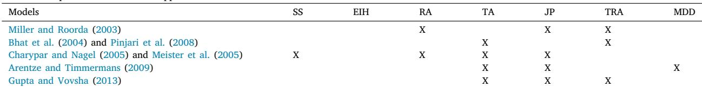

Table 1 Features comparison of the current approaches in the literature

本地MinerU提取的原图与图注 · CC BY 4.0 · Negar Rezvany; Michel Bierlaire; Tim Hillel · 10.1016/j.trc.2023.104362

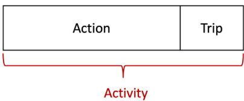

Fig. 1. Definition of activity in our framework.

本地MinerU提取的原图与图注 · CC BY 4.0 · Negar Rezvany; Michel Bierlaire; Tim Hillel · 10.1016/j.trc.2023.104362

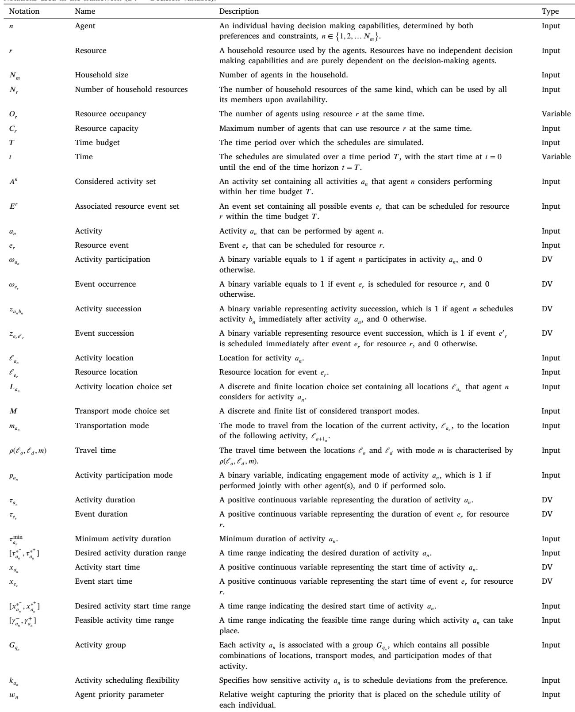

Table 2 Notations used in the framework (DV = Decision variable).

本地MinerU提取的原图与图注 · CC BY 4.0 · Negar Rezvany; Michel Bierlaire; Tim Hillel · 10.1016/j.trc.2023.104362

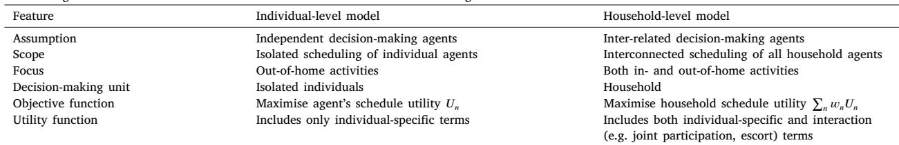

Table 3 Methodological differences between individual-level and household-level scheduling model with interactions.

本地MinerU提取的原图与图注 · CC BY 4.0 · Negar Rezvany; Michel Bierlaire; Tim Hillel · 10.1016/j.trc.2023.104362

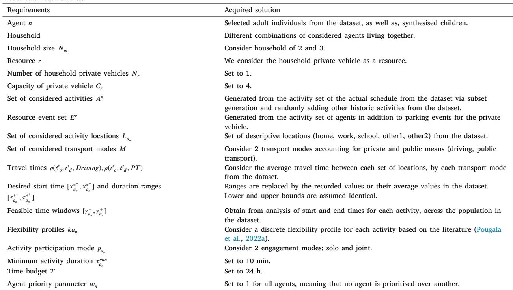

Table 4 Model data requirements.

本地MinerU提取的原图与图注 · CC BY 4.0 · Negar Rezvany; Michel Bierlaire; Tim Hillel · 10.1016/j.trc.2023.104362

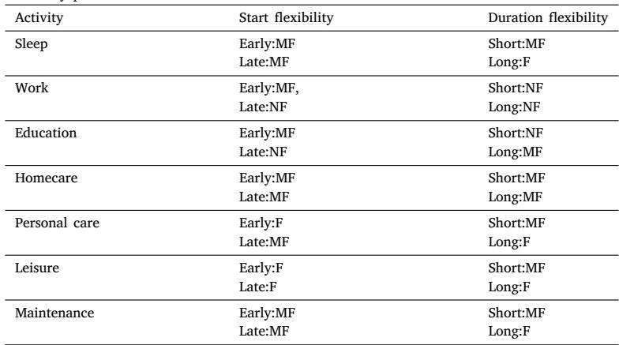

Table 5 Flexibility profiles for activities in the UK TUS.

本地MinerU提取的原图与图注 · CC BY 4.0 · Negar Rezvany; Michel Bierlaire; Tim Hillel · 10.1016/j.trc.2023.104362

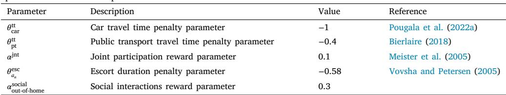

Table 6 Specifications of the model parameters.

本地MinerU提取的原图与图注 · CC BY 4.0 · Negar Rezvany; Michel Bierlaire; Tim Hillel · 10.1016/j.trc.2023.104362

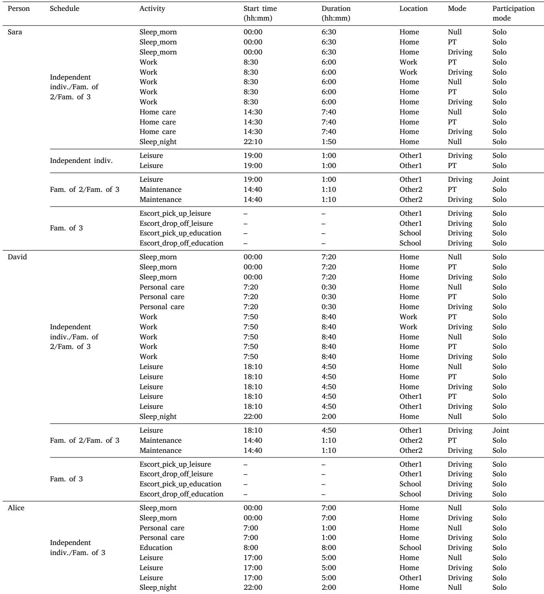

Table 7 Considered activities and preferences for each agent.

本地MinerU提取的原图与图注 · CC BY 4.0 · Negar Rezvany; Michel Bierlaire; Tim Hillel · 10.1016/j.trc.2023.104362

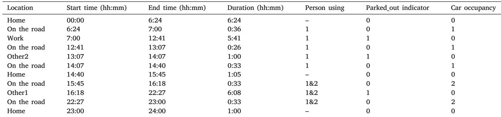

Table 8 Car location sequence and occupancy in the example of family of 2.

本地MinerU提取的原图与图注 · CC BY 4.0 · Negar Rezvany; Michel Bierlaire; Tim Hillel · 10.1016/j.trc.2023.104362

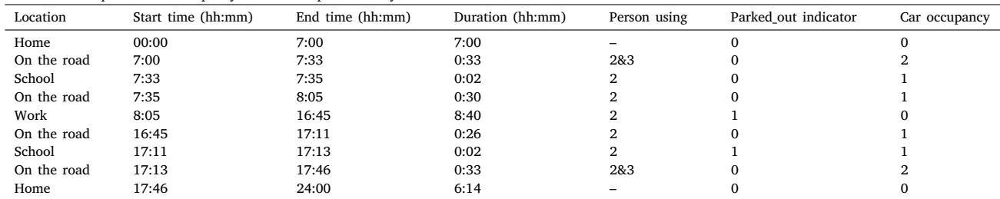

Table 9 Car location sequence and occupancy in the example of family of 3.

本地MinerU提取的原图与图注 · CC BY 4.0 · Negar Rezvany; Michel Bierlaire; Tim Hillel · 10.1016/j.trc.2023.104362

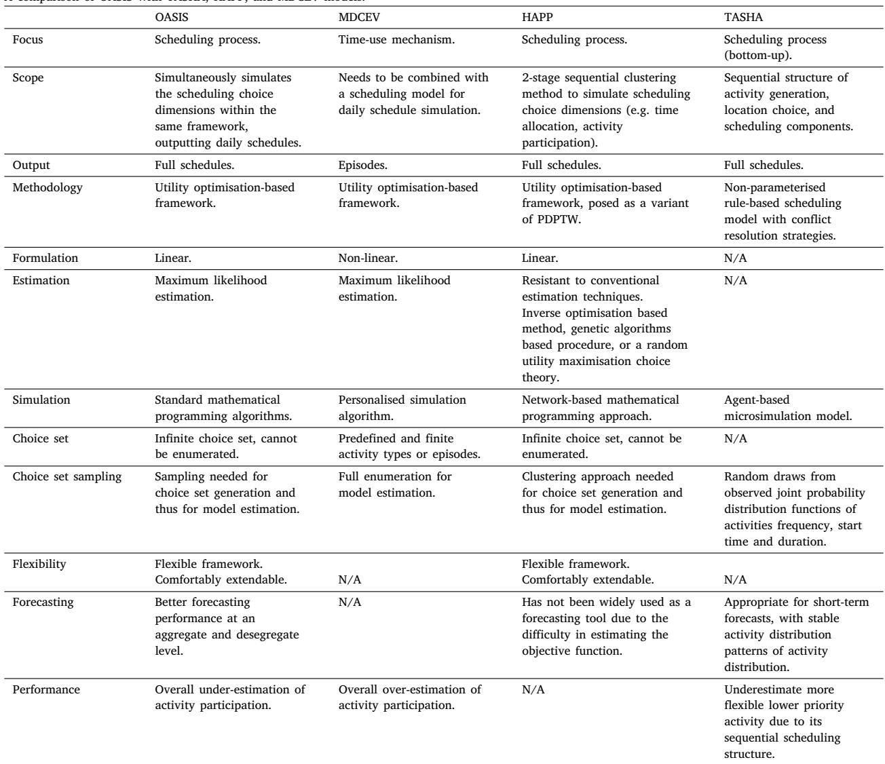

Table 10 A comparison of OASIS with TASHA, HAPP, and MDCEV models.

本地MinerU提取的原图与图注 · CC BY 4.0 · Negar Rezvany; Michel Bierlaire; Tim Hillel · 10.1016/j.trc.2023.104362

